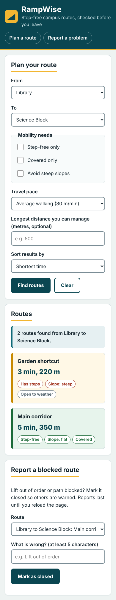
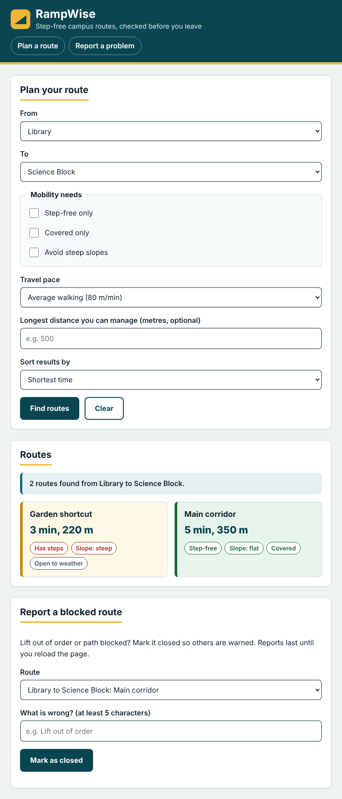
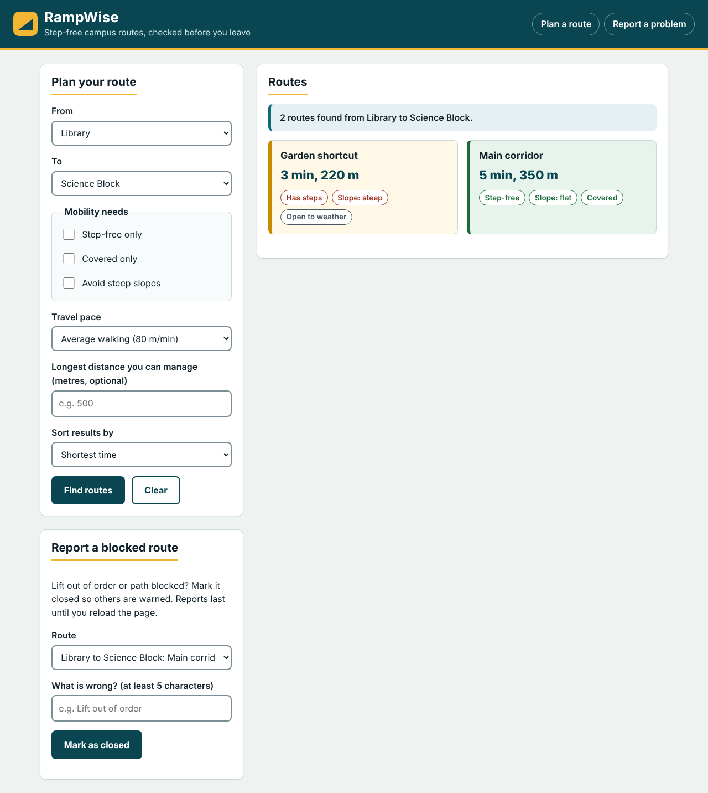

# RampWise: Accessible Campus Route Planner

**Assigned idea: Accessible Campus Route Planner** 
**Author: Nida Shah**
**CMSid:507819**
**Submitted to:Dr. Muhammad Khuram Shahzad**
**Course:CS-344-Web Engineering B 2K24-BESE-15**
## User and problem
A student or visitor with a mobility need (wheelchair, crutches, low stamina, stroller) must get between campus buildings. Normal maps do not show steps, steep slopes or broken lifts. The planner filters routes by those needs and shows travel time and warnings.

## Run it
No build step or backend. Download or clone the repo and open `index.html` in a browser.
Optional local server: `python -m http.server 8000`, then visit http://localhost:8000.
Live URL:https://nidashah612.github.io/rampwise-campus-route-planner/

## Features
- Route finder: filters by building pair, step-free, covered, steep slope, maximum distance; sort by time or accessibility.
- Live travel-time calculation from the chosen pace.
- Report a blocked route: marks a route closed in memory, with warnings on cards.
- Edge cases: empty selection, same start and destination, no matches, closed routes, invalid distance.
- Responsive: mobile (default), tablet (600px), desktop (1024px).

## Client vs server
The browser does all validation, filtering, calculation and rendering from the in-memory array in `data.js`. A server (Assignments 2 and 3) would store routes and reports and manage users.

## WDLC summary
Planning (user and scope), analysis (needs and data), design (wireframes in /docs), implementation (HTML, CSS, JS), testing (manual cases above), deployment (GitHub Pages), maintenance (update routes, fix reports).

## Screenshots

Design report: `docs/Design-Report.pdf` (editable copy: `docs/Design-Report.docx`). Wireframe: `docs/wireframe.svg`.

## AI assistance disclosure
Claude generated the first draft of the code; I reviewed, tested and modified it.

## Attribution
No external libraries, templates or assets. All sample data is invented.
